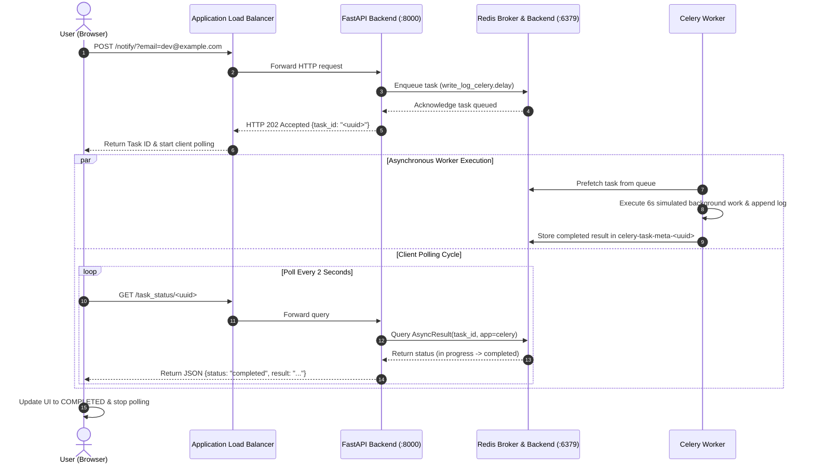

# Production-Ready Containerized Application with AWS, Terraform & CI/CD

[](https://github.com/divyaaax/devops-assignment/actions/workflows/ci.yml)
[](LICENSE)
[](https://www.python.org/)
[](https://www.docker.com/)
[](https://www.terraform.io/)

---

## Submission Deliverables

| Requirement | Location / Reference | Description |
| :--- | :--- | :--- |
| **Full Source Code** | [`backend/`](backend/), [`frontend/`](frontend/), [`Dockerfile.backend`](Dockerfile.backend), [`Dockerfile.worker`](Dockerfile.worker), [`docker-compose.yml`](docker-compose.yml) | Asynchronous task processor built with FastAPI, Celery, Redis, and HTML5 frontend. |
| **Infrastructure as Code (IaC)** | [`infra/terraform/`](infra/terraform/) | Production AWS Terraform modules for multi-AZ VPC, ALB, ECS Fargate, ECR, ElastiCache Redis, and CloudWatch. |
| **CI/CD Configuration** | [`.github/workflows/ci.yml`](.github/workflows/ci.yml), [`.github/workflows/deploy.yml`](.github/workflows/deploy.yml) | Keyless AWS OIDC authentication, automated linting, pytest, Trivy container security scanning, and ECS rollout. |
| **README.md Setup Steps** | [Section 5](#5-quickstart-running-locally-with-docker-compose) & [Section 7](#7-cloud-deployment-with-terraform-aws) | Detailed local Docker Compose, host virtualenv, and AWS Terraform deployment steps. |
| **Video Walkthrough** | [Video Walkthrough](#video-walkthrough) & [`docs/video-walkthrough.md`](docs/video-walkthrough.md) | 5–8 minute presentation covering code architecture, containerization, local execution, and CI/CD deployment pipeline. |

---

## Video Walkthrough

> **Presentation Video**: [Watch the Video Walkthrough](docs/video-walkthrough.md) *(or insert your Loom / YouTube / Google Drive link here)*
>
> A detailed 5–8 minute walkthrough explaining:
> 1. **Code Architecture & Task Lifecycle**: How FastAPI, Celery, and Redis process asynchronous background tasks.
> 2. **Local Multi-Service Orchestration**: Starting the stack with Docker Compose and observing real-time worker logs.
> 3. **Infrastructure as Code (IaC)**: Reusable Terraform modules provisioning AWS VPC, ALB, ECS Fargate, and ElastiCache Redis.
> 4. **CI/CD Pipeline & Deployment**: Automated linting, test suites, Trivy CVE scanning, and AWS OIDC deployment to ECS.
>
> The complete speaker script is available in [`docs/video-walkthrough.md`](docs/video-walkthrough.md).

---

## 1. Project Overview

This repository delivers a complete, production-grade DevOps implementation for an asynchronous distributed task processing platform. The application couples a **FastAPI** web service, an asynchronous **Celery** background worker pool, a **Redis** message broker and result store, and a modern single-page **frontend**.

### Key Deliverables Included
- **Multi-Stage Containerization**: Minimized attack surface using `python:3.11-slim`, non-root user execution (`appuser`, UID 10001), healthchecks, and signal-handling shutdown.
- **Local Multi-Service Orchestration**: Fully automated `docker-compose.yml` with custom bridge networking and health-dependent startup.
- **Centralized & Validated Configuration**: Strong typing via `pydantic-settings` with environment variable injection and automatic secret masking.
- **Infrastructure as Code (Terraform)**: Modular AWS infrastructure provisioning a multi-AZ VPC, Application Load Balancer, Amazon ECR, Amazon ECS (Fargate), Amazon ElastiCache (Redis 7.x), and CloudWatch monitoring.
- **Automated CI/CD Pipeline (GitHub Actions)**: Zero-credential AWS authentication via OpenID Connect (OIDC), automated flake8 linting, pytest suite, Trivy container security scanning, immutable Git commit-SHA image publishing, and rolling ECS deployments.
- **Comprehensive Testing & Observability**: Automated unit and integration tests with mock fixtures, CloudWatch metric alarms, and container health probes.

---

## 2. Distributed Task Lifecycle Journey



1. **Submission**: The user enters an email in `frontend/index.html` and triggers `POST /notify/?email=...`.
2. **Enqueue**: FastAPI validates the email format and pushes the job to Redis via Celery.
3. **Immediate Acknowledgement**: FastAPI returns HTTP 202 with the `task_id` in milliseconds without blocking.
4. **Worker Execution**: The Celery worker daemon claims the task from the Redis queue, simulates work (6 seconds), writes to the log, and saves the task result in Redis.
5. **Polling & Resolution**: The frontend polls `GET /task_status/{task_id}` every 2 seconds. When the result is ready in Redis, FastAPI returns `{"status": "completed", "result": "..."}`, and the frontend presents the result.

---

## 3. Technology Stack

| Layer | Technologies |
| :--- | :--- |
| **Backend API** | Python 3.11, FastAPI, Uvicorn, Pydantic, Pydantic-Settings |
| **Worker & Queue** | Celery 5.x, Redis 7.x, Kombu |
| **Frontend** | Responsive Vanilla HTML5, CSS3, JavaScript (Fetch API) |
| **Containerization** | Docker, Docker Compose, Multi-stage Builds, Non-root containers |
| **Cloud Infrastructure (AWS)** | VPC (Multi-AZ), ECS Fargate, ECR, ElastiCache Redis, ALB, CloudWatch |
| **Infrastructure as Code** | HashiCorp Terraform (v1.5+), AWS Provider v5.x |
| **CI/CD Pipeline** | GitHub Actions, AWS OIDC (Keyless Auth), Trivy Container Scanner |
| **Testing** | Pytest, Pytest-Mock, HTTPX (TestClient) |

---

## 4. Repository Structure

```text
devops-assignment/
├── backend/
│   ├── config.py                 # Centralized, strongly-typed settings & secret masking
│   ├── main.py                   # FastAPI application & endpoints (/health, /notify, /task_status)
│   ├── worker.py                 # Celery worker process & task logic
│   ├── requirements.txt          # Python dependencies
│   └── tests/                    # Automated test suite
│       ├── test_config.py        # Config & secret masking tests
│       ├── test_health.py        # Healthcheck endpoint tests
│       ├── test_api.py           # API validation & async polling tests
│       └── test_worker.py        # Celery task execution tests
├── frontend/
│   └── index.html                # Single-page client with dynamic API resolution
├── Dockerfile.backend            # Multi-stage Docker build for FastAPI
├── Dockerfile.worker             # Multi-stage Docker build for Celery Worker
├── docker-compose.yml            # Local 3-tier container orchestration
├── .dockerignore                 # Excludes cache, secrets, and terraform files from images
├── .gitignore                    # Comprehensive git ignores
├── .env.example                  # Template environment variables for local runs
├── Makefile                      # Convenient CLI shortcuts (make up, make test, etc.)
├── infra/
│   └── terraform/
│       ├── bootstrap/            # S3 bucket & DynamoDB table for remote state
│       ├── modules/
│       │   ├── networking/       # VPC, subnets, route tables, security groups, NAT toggle
│       │   ├── ecr/              # ECR repositories, scanning & lifecycle rules
│       │   ├── load_balancer/    # Application Load Balancer & Target Groups
│       │   ├── redis/            # Managed Amazon ElastiCache for Redis
│       │   ├── ecs/              # ECS Cluster, Task Definitions, IAM roles, Fargate services
│       │   └── monitoring/       # CloudWatch alarms for CPU, memory, and ALB 5XX
│       └── environments/
│           └── dev/              # Dev environment composition (main, variables, outputs)
├── .github/
│   └── workflows/
│       ├── ci.yml                # CI: Linting, pytest, docker builds, Trivy security scan
│       └── deploy.yml            # CD: AWS OIDC auth, ECR push, ECS rollout, health check
├── docs/
│   ├── architecture.md           # Detailed Mermaid architecture diagrams
│   └── video-walkthrough.md      # 5-8 minute presentation and recording script
├── instructions.md               # Beginner-friendly local development guide
├── journey.md                    # Engineering journey, decisions & verified resolutions
└── README.md                     # Complete project documentation
```

---

## 5. Quickstart: Running Locally with Docker Compose

### Prerequisites
- Docker & Docker Compose installed and running.
- Git.

### Step 1: Clone and Configure Environment
```bash
# Clone the repository
git clone https://github.com/divyaaax/devops-assignment.git
cd devops-assignment

# Copy environment variables
cp .env.example .env
# Windows PowerShell: Copy-Item .env.example .env
```

### Step 2: Build and Start Containers
```bash
make up
# Or: docker compose up -d --build
```

### Step 3: Verify Container Health
```bash
docker compose ps
```
You should see `devops-redis`, `devops-backend`, and `devops-worker` running and healthy.

### Step 4: Open the Frontend
Navigate to [http://localhost:8000](http://localhost:8000) in your browser.
Enter an email (e.g. `engineer@example.com`) and click **Send notification**.

### Step 5: Follow Service Logs
```bash
make logs
# Or: docker compose logs -f
```

### Step 6: Stop the Stack
```bash
make down
# To clean up volumes completely: make clean
```

---

## 6. Running Automated Tests

The test suite runs with `pytest` and mocks external dependencies so it executes rapidly in any environment:

```bash
# Set PYTHONPATH and run pytest
export PYTHONPATH=backend
pytest -v backend/tests

# Windows PowerShell:
$env:PYTHONPATH="backend"
pytest -v backend/tests
```

### Verified Test Results (15/15 Passed):
```text
backend/tests/test_api.py::test_notify_success PASSED               [  6%]
backend/tests/test_api.py::test_notify_invalid_email PASSED         [ 13%]
backend/tests/test_api.py::test_notify_empty_email PASSED           [ 20%]
backend/tests/test_api.py::test_notify_broker_down PASSED           [ 26%]
backend/tests/test_api.py::test_task_status_completed PASSED        [ 33%]
backend/tests/test_api.py::test_task_status_failed PASSED           [ 40%]
backend/tests/test_api.py::test_task_status_in_progress PASSED      [ 46%]
backend/tests/test_config.py::test_default_settings PASSED          [ 53%]
backend/tests/test_config.py::test_cors_origins_parsing PASSED      [ 60%]
backend/tests/test_config.py::test_ssl_redis_url_generation PASSED  [ 66%]
backend/tests/test_config.py::test_safe_dict_masks_secrets PASSED   [ 73%]
backend/tests/test_health.py::test_health_get PASSED                [ 80%]
backend/tests/test_health.py::test_health_get_trailing_slash PASSED [ 86%]
backend/tests/test_health.py::test_health_post_compatibility PASSED [ 93%]
backend/tests/test_worker.py::test_write_log_celery_execution PASSED [100%]
======================== 15 passed in 0.58s ========================
```

---

## 7. Cloud Deployment with Terraform (AWS)

### Architecture Highlights
- **VPC**: 2 Public Subnets (for ALB) + 2 Private Subnets (for Redis & tasks).
- **Security Groups**:
  - `alb-sg`: Public HTTP (80) & HTTPS (443).
  - `ecs-backend-sg`: Inbound port 8000 allowed *only* from `alb-sg`.
  - `ecs-worker-sg`: Zero inbound ports allowed.
  - `redis-sg`: Inbound port 6379 allowed *only* from `ecs-backend-sg` and `ecs-worker-sg`.
- **Cost Optimization Toggle**: `enable_nat_gateway = false` by default for dev assessment, avoiding ~$35/month AWS NAT Gateway charges.

### Terraform Execution Steps

```bash
# 1. Navigate to dev environment
cd infra/terraform/environments/dev

# 2. Copy example variables
cp terraform.tfvars.example terraform.tfvars

# 3. Initialize Terraform
terraform init

# 4. Preview Infrastructure Plan
terraform plan

# 5. Apply Infrastructure
terraform apply -auto-approve
```

### Outputs
Upon completion, Terraform outputs:
- `application_url`: Public URL to access the deployed application (e.g. `http://devops-assessment-dev-alb-12345.us-east-1.elb.amazonaws.com`).
- `ecr_backend_repository_url`: Backend ECR repository URI.
- `ecr_worker_repository_url`: Worker ECR repository URI.
- `ecs_cluster_name`: Name of the ECS cluster.
- `redis_endpoint`: Primary ElastiCache hostname (credentials masked).

---

## 8. GitHub Actions CI/CD & AWS OIDC Setup

### Workflows Included
1. **`.github/workflows/ci.yml`**:
   - Runs on every Pull Request and Push to `main`.
   - Executes flake8 linting, pytest test suite with coverage, builds backend & worker Docker images, and scans both images with **Trivy** for CVE vulnerabilities.
2. **`.github/workflows/deploy.yml`**:
   - Runs on Push to `main` with concurrency control.
   - Authenticates to AWS via **OIDC** (`aws-actions/configure-aws-credentials`).
   - Builds, tags with the immutable Git commit SHA, and pushes images to Amazon ECR.
   - Deploys new task definitions to ECS Fargate services and waits for service stability.
   - Executes automated endpoint health verification against the ALB `/health` URL.

### Required GitHub Repository Configuration

#### GitHub Actions Secret:
- `AWS_ROLE_TO_ASSUME`: The ARN of the IAM Deployment Role created for GitHub OIDC (e.g. `arn:aws:iam::123456789012:role/GitHubActionsECRDeployRole`).

#### GitHub Actions Variables:
- `AWS_REGION`: Target AWS region (e.g. `us-east-1`).
- `ALB_DNS_NAME`: DNS name of the ALB output from Terraform (e.g. `devops-assessment-dev-alb-xxx.us-east-1.elb.amazonaws.com`).
- `ECS_CLUSTER_NAME`: `devops-assessment-dev-cluster`.
- `BACKEND_SERVICE_NAME`: `devops-assessment-dev-backend-service`.
- `WORKER_SERVICE_NAME`: `devops-assessment-dev-worker-service`.

---

## 9. Security Best Practices Implemented

- **No Hardcoded Secrets**: All connection strings and configurations are injected via environment variables.
- **Keyless Cloud Authentication**: AWS OIDC eliminates long-lived IAM access keys in GitHub Secrets.
- **Non-Root Containers**: Containers run under unprivileged UID `10001` (`appuser`).
- **Network Isolation**: Redis is strictly contained inside private subnets with no public internet ingress.
- **Least Privilege IAM**: Separate Task Execution and Task Workload roles.
- **Image Scanning**: Automatic container vulnerability scanning on push via ECR and Trivy.
- **Graceful Termination**: Uses `exec` signal forwarding to prevent task truncation during deployment rollouts.

---

## 10. Cost Teardown & Cleanup

To avoid ongoing AWS cloud charges when the evaluation is complete:

```bash
cd infra/terraform/environments/dev
terraform destroy -auto-approve
```

> [!NOTE]
> Deleting ECS services alone does NOT terminate all billable resources. Running `terraform destroy` ensures that the Application Load Balancer, ElastiCache cluster, VPC Elastic IPs, and CloudWatch log groups are completely terminated.

---

## 11. Operational Troubleshooting

| Symptom | Probable Cause | Action |
| :--- | :--- | :--- |
| **503 Broker Unavailable** | Redis service stopped or network mismatch | Check `REDIS_HOST=redis` in `.env` and run `docker compose ps redis`. |
| **ALB 502 Bad Gateway** | Backend tasks failing health check `/health` | Check `/ecs/devops-assessment-dev-backend` CloudWatch logs. Ensure port 8000 is open in `ecs-backend-sg`. |
| **Worker Not Consuming** | Celery worker process stopped | Inspect worker logs: `docker compose logs -f worker` or CloudWatch `/ecs/worker`. |
| **Task Status Never Completes** | Celery worker crashed during task execution | Check `CELERY_LOG_FILE` or Redis connectivity from worker container. |