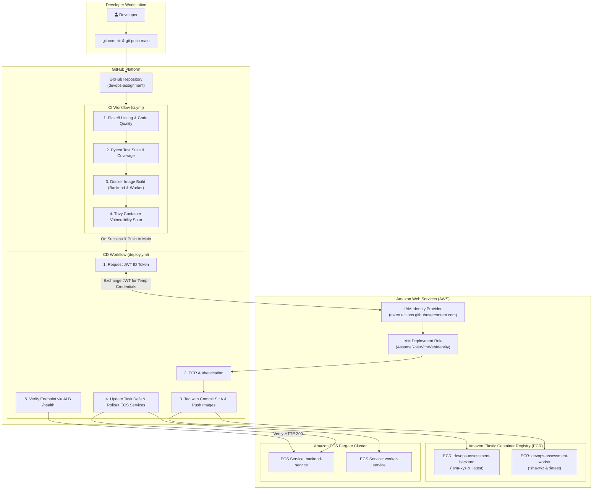
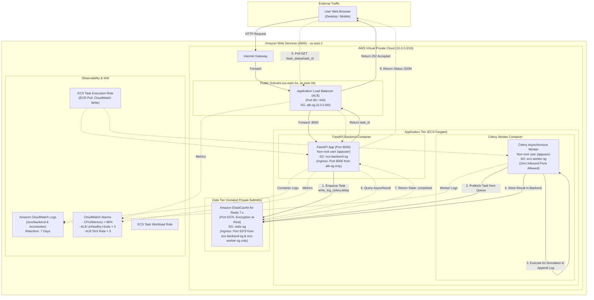

# System Architecture & Cloud Infrastructure

This document outlines both the **CI/CD Deployment Architecture** and the **AWS Runtime Cloud Architecture** for the containerized application.

---

## 1. CI/CD Deployment Architecture

The following diagram illustrates the automated deployment pipeline from local code commit through GitHub Actions, AWS OIDC authentication, Amazon ECR image registry, and Amazon ECS Fargate deployment:

---

## 2. AWS Runtime Cloud Architecture

The following diagram depicts the AWS cloud architecture, isolating services across public and private subnets, security groups, load balancing, message queuing, and CloudWatch monitoring:

---

## 3. Distributed Task Lifecycle Journey

1. **User Action**: The client triggers the notification form in `frontend/index.html`.
2. **FastAPI Request**: The browser submits `POST /notify/?email=user@example.com` to the Application Load Balancer, which routes to the backend on port 8000.
3. **Queue Enqueue**: FastAPI invokes `write_log_celery.delay()`. Celery serializes the task into Redis queue `celery`.
4. **Immediate Response**: FastAPI immediately returns HTTP 202 Accepted: `{"message": "Email will be sent to...", "task_id": "<uuid>"}` without blocking.
5. **Worker Pickup**: The headless Celery worker polls Redis, claims the job, and updates task state to `STARTED`.
6. **Execution**: The worker simulates background work, writes the audit log, and finishes.
7. **Result Persistence**: Celery stores the result string (`Task completed: ...`) in Redis key `celery-task-meta-<uuid>`.
8. **Client Polling**: The frontend periodically queries `GET /task_status/<uuid>` every 2 seconds.
9. **Result Return**: FastAPI queries `AsyncResult(task_id, app=celery)`. Once `ready()` is true, it returns `status: "completed"` and the result string.
10. **UI Update**: The frontend displays the completed state, stops polling, and updates the progress indicator.
